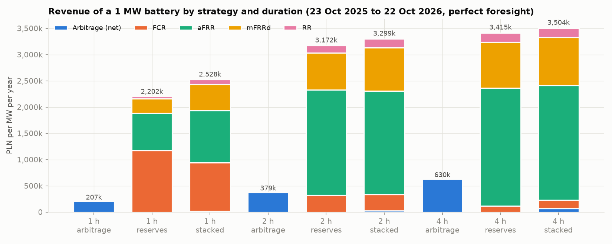
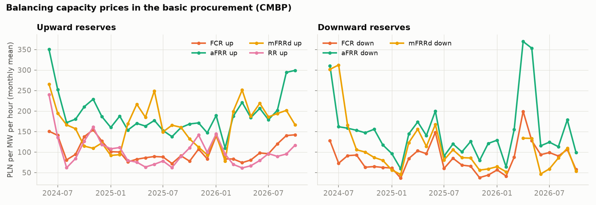
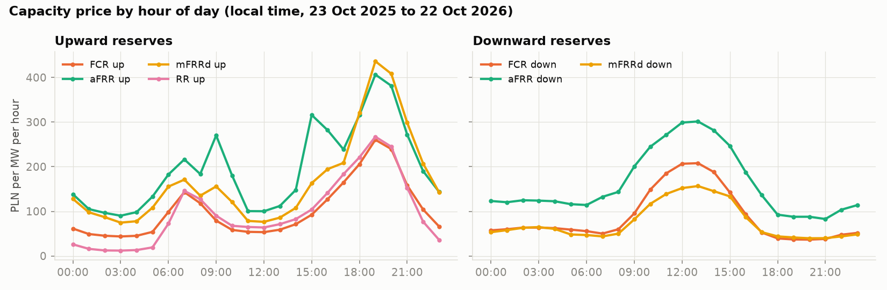
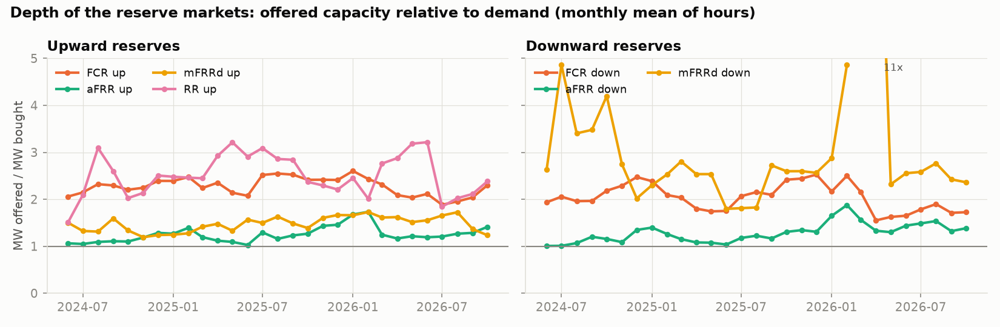
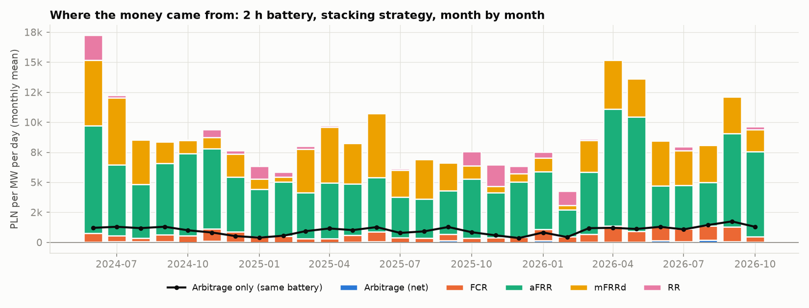
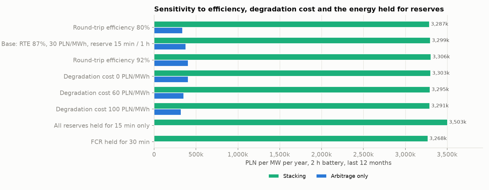
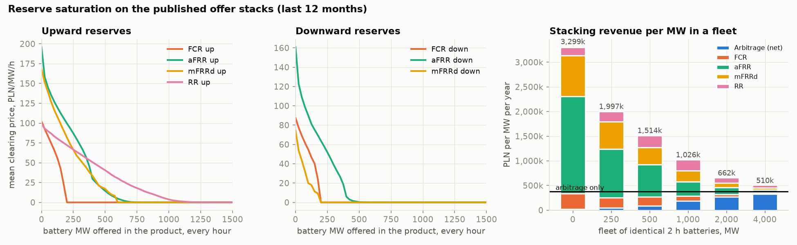

# pl-bess-revenue-stack


**Dashboard: https://kwwaleszczynski-del.github.io/pl-bess-revenue-stack/**

How much can a battery earn in Poland by combining day-ahead arbitrage with balancing services, and how many
megawatts of batteries can the Polish reserve markets absorb before those earnings disappear? This project
backtests a 1 MW battery that sells energy arbitrage and balancing capacity (FCR, aFRR, mFRRd, RR) in the same
hours, on public data of the transmission system operator PSE since the balancing market reform of 14 June 2024,
and then floods the published offer stacks with batteries to see how fast reserve prices fall.

## Key results

1 MW battery, perfect foresight, PLN per MW of power per year, last 12 months (23 October 2025 to 22 October 2026):

| Duration | Arbitrage only | Reserves only | **Stacking** | Stacking, full year 2025 | Capacity market, 2030 auction terms |
|---|---:|---:|---:|---:|---:|
| 1 h | 207k | 2,202k | **2,528k** | 2,046k | + 62k |
| 2 h | 379k | 3,172k | **3,299k** | 2,710k | + 62k |
| 4 h | 630k | 3,415k | **3,504k** | 2,866k | + 62k |

- **A lone battery earns almost everything from balancing capacity.** For 2 h, stacking was worth 3.30 M PLN/MW in
  the last 12 months, almost nine times arbitrage alone; 99% came from capacity payments: aFRR 60%, mFRRd 25%, FCR 9%,
  RR 5%. A 1 h battery leans on FCR (37%), which needs only 15 minutes of energy.
- **But the reserve markets are a few hundred megawatts each.** On average PSE bought 192 MW of FCR per
  direction, 452 / 411 MW of aFRR up / down, 465 / 120 MW of mFRRd and 607 MW of RR per hour (hours with demand,
  last 12 months). In every product a block of 75-425 MW of batteries halves the mean clearing price, and FCR
  falls below a tenth of its price at 200 MW.
- **They fill up quickly.** In a fleet of identical 2 h batteries that all stack, revenue per MW falls from 3.30 M
  to 2.00 M with 250 MW, 1.03 M with 1 GW and 0.51 M with 4 GW, where reserves bring only 0.18 M and arbitrage is
  the main income again (arbitrage alone: 0.38 M; arbitrage prices are kept as observed).
- **The capacity market adds little for new batteries:** 62k PLN/MW/year under the 2030 auction (465.02 PLN/kW/year
  x KWD 13.39%), against 162k under the 2029 auction (KWD 61.30%).
- **aFRR activation energy** priced ex post with pro-rata activation adds about 252k PLN/MW/year (+8%) for 2 h.
- **These are upper bounds** (perfect foresight, a price-taker until the saturation model, rules simplified). They
  describe what the market paid, not what a project will earn. Not investment advice.




## The problem

Battery storage is arriving in Poland at scale: PSE's CEO expected up to about 1 GW of batteries to start
operating in 2026, and the 200 MW / 800 MWh unit in Nowa Wieś Ełcka was energised on 16 June 2026
([Gramwzielone, 19 June 2026](https://www.gramwzielone.pl/magazynowanie-energii/20363672/polska-ma-najwiekszy-magazyn-energii-w-europie-bess-elk-podlaczony-do-sieci)).
A battery has three revenue layers: energy arbitrage, balancing services and, for some, a capacity market
contract. Balancing capacity has been by far the richest layer, but the markets are small: PSE buys a couple of
hundred MW of FCR and a few hundred MW of aFRR per direction. The investment question is how much stacking is
worth today and what is left when gigawatts of batteries compete for a few hundred megawatts of reserves.

## Data

All inputs are public reports of the Polish transmission system operator PSE, read from the reports API
`https://api.raporty.pse.pl/api` without a key. Field meanings and units were checked against the PSE report pages
(raporty.pse.pl) and the API field map ([EndpointsMap.pdf](https://api.raporty.pse.pl/EndpointsMap.pdf)):

| Report | Fields used | Meaning | Resolution |
|---|---|---|---|
| `rce-pln` | `rce_pln` | RCE, day-ahead market price, PLN/MWh | 15 min (hourly values until 30 Sep 2025) |
| `csdac-pln` | `csdac_pln` | SDAC price for the Polish zone, PLN/MWh (downloaded, not used in the results) | 15 min |
| `cmbp-tp` | `fcr_g`, `fcr_d`, `afrr_g`, `afrr_d`, `mfrrd_g`, `mfrrd_d`, `rr_g` | CMBP, price of balancing capacity bought in the basic (day-ahead) procurement, PLN per MW per hour (`zł/MW-h`) | hourly |
| `mbp-tp` | same | balancing capacity bought in the basic procurement, MW | hourly |
| `cmbu-tu` / `mbu-tu` | same without RR | price and MW of balancing capacity bought in the **supplementary** procurement (capacity, not activations); the MW are used for market depth and the aFRR activation ratio | 15 min |
| `popmb-rmb` | `reserve_type`, `pom`, `com` | anonymous portfolio offers for balancing capacity in the basic procurement: MW and offer price | hourly, ~6,000 rows per day |
| `eb-rozl` | `eb_afrrg`, `eb_afrrd` | balancing energy from aFRR activated on the European aFRR platform, MWh per 15 min | 15 min, published from 11 July 2025 |
| `crb-rozl` | `ceb_sr_afrrg_cost`, `ceb_sr_afrrd_cost` | average balancing energy price of aFRR activations up / down, PLN/MWh | 15 min, settlement data published with a delay |

Suffix `_g` (góra) is upward, `_d` (dół) downward. RR is only bought upwards. The data are read with
[pse-opendata](https://pypi.org/project/pse-opendata/), which converts `dtime_utc` (the **end** of each interval) to
the interval start and caches monthly Parquet files in `data/` (not part of the repository). Offers are requested
one business day at a time in a single page: the keyset paging of the API skips repeated offers at page
boundaries, so the monthly paged download used before lost 39 of 5,263,971 hourly offers (0.0007 %, 469 MW
offered in total, in 21 of 29 months); the results below include them.

## Rules for batteries in the Polish reserve markets

The balancing rules are the PSE *Warunki Dotyczące Bilansowania* (WDB, terms and conditions related to balancing
under EU Regulation 2017/2195), approved by the energy regulator URE and amended several times a year. The points
that matter for this model, as read on 22 October 2026 (**they change often; check the current text before reuse**):

- **Activation times.** WDB Annex 2 (qualification of balancing service providers, in force since 14 June 2024),
  point 4(7.2): FCR is activated automatically from local frequency measurement with full activation time (FAT)
  up to 30 s; aFRR automatically through PSE's LFC system, FAT up to 5 min; mFRRd manually by PSE, directly, FAT up to
  12.5 min; RR through a change of the base point, FAT up to 30 min.
- **Batteries qualify per direction.** For storage scheduling units (JGM), qualification is carried out separately
  for the generation and the consumption direction (Annex 2, 4(8)), and the unit must be able to activate each
  reserve continuously over its whole qualified range (4(14)).
- **No explicit energy duration for aFRR, mFRRd and RR.** The WDB text does not state how many hours of full power
  a limited-energy unit must hold for these products. Capacity is bought per one-hour procurement period, so the
  model assumes **one hour of full contracted power** per MW of aFRR, mFRRd or RR, and tests 15 minutes as a
  sensitivity.
- **FCR from limited energy reservoirs: 15 minutes.** Article 156(9) of the EU System Operation Guideline
  (Regulation 2017/1485) requires FCR providers with limited energy reservoirs to be able to fully activate FCR
  from the alert state for at least 15 minutes (or a period set by the TSO between 15 and 30 minutes) as long as
  no minimum activation period has been set for the synchronous area. For Continental Europe that proposal is still
  open: [ACER Decision 01/2026](https://www.acer.europa.eu/sites/default/files/documents/Individual%20Decisions/ACER-Decision-01-2026-CESA-NRA-extension-minimum-activation-period-FCRs.pdf)
  of 30 January 2026 extended the regulators' deadline to 17 June 2026, noting that batteries also lose energy in
  normal-state deviations before the alert state, so their reservoir has to be larger than the minimum period
  alone (whether a value has been adopted since was not checked). The model uses 15 minutes and tests 30 minutes.
- **Price caps and a competition test from 2026.** WDB amendment 5/2026 (approved; explanatory note of 14 July 2026)
  introduces from 31 July 2026 an upper limit of balancing capacity offers, until 31 December 2027 at
  5,000 PLN/MW-h upwards and 2,500 PLN/MW-h downwards, and from 1 December 2026 a competition criterion: when
  demand cannot be covered without any single provider, demand in the basic procurement is reduced and offer
  prices are capped at the higher of the clearing price, a reference price and the SDAC price.
- **Planned from 1 December 2026** (amendment 6/2026, sent to URE): connection to the European mFRR platform and
  daily (DLOM) and hourly (GLOM) limits in capacity offers, which let energy-limited providers express their
  daily energy budget directly.

## Method

**Battery.** 1 MW, durations 1, 2 and 4 h, round-trip efficiency 87% split evenly between charging and
discharging ($`\eta = \sqrt{0.87}`$), usable state of charge 5-95%, at most 1.5 full cycles per day, degradation cost
30 PLN per MWh discharged, state of charge 50% at the start and the end of every day. These are the parameters of
[bess-arbitrage-pl](https://github.com/kwwaleszczynski-del/bess-arbitrage-pl), so the arbitrage-only results can
be compared one to one.

**Daily optimisation.** Every delivery day is a mixed-integer linear program (HiGHS through SciPy). The battery
chooses charging $`c_t`$ and discharging $`d_t`$ (MW) in each quarter-hour $`t`$ ($`\Delta t`$ = 0.25 h) and the
capacity $`r_{h,k}`$ (MW) sold in each product $`k`$ in each hour $`h`$:

```math
\max \; \sum_t p_t \, \Delta t \, (d_t - c_t) \;-\; \kappa \sum_t \Delta t \, d_t \;+\; \sum_h \sum_k \pi_{h,k} \, r_{h,k}
```

where $`p_t`$ is the RCE price (PLN/MWh), $`\kappa`$ the degradation cost and $`\pi_{h,k}`$ the clearing price of the
basic capacity procurement (PLN per MW per hour). Constraints, with $`h(t)`$ the hour of quarter-hour $`t`$ and
$`\uparrow`$, $`\downarrow`$ the upward and downward products:

```math
\begin{aligned}
& s_t = s_{t-1} + \eta \, \Delta t \, c_t - \Delta t \, d_t / \eta , \qquad s_{\min} \le s_t \le s_{\max} , \qquad s_T = s_0 \
& 0 \le c_t \le P \, u_t , \qquad 0 \le d_t \le P \, (1 - u_t) , \qquad u_t \in \{0, 1\} \
& d_t - c_t + \sum_{k \in \uparrow} r_{h(t),k} \le P , \qquad c_t - d_t + \sum_{k \in \downarrow} r_{h(t),k} \le P \
& s - \sum_{k \in \uparrow} T_k \, r_{h(t),k} / \eta \ \ge\ s_{\min} , \qquad s + \sum_{k \in \downarrow} T_k \, r_{h(t),k} \, \eta \ \le\ s_{\max} \qquad \text{for } s \in \{s_{t-1}, s_t\} \
& \sum_t \Delta t \, d_t \le N \, (s_{\max} - s_{\min})
\end{aligned}
```

The third line is the power headroom: power sold as reserve cannot also be used for arbitrage. The fourth line is
the **SoC reserve**: at the start and the end of every quarter-hour the battery holds enough energy (and enough
empty space) to deliver every contracted MW at full power for $`T_k`$ hours on top of its arbitrage schedule, with
$`T_k`$ = 0.25 h for FCR and 1 h for aFRR, mFRRd and RR (see the rules above). The binary $`u_t`$ forbids
simultaneous charging and discharging; the last line caps throughput at $`N`$ = 1.5 full cycles a day. Products not
bought in an hour cannot be sold.

**Strategies.** *Arbitrage only* ($`r = 0`$), *reserves only* ($`c = d = 0`$, the state of charge stays at 50%)
and *stacking* (everything at once). Stacking contains both other strategies as special cases, so it can never earn
less on any day; the tests check this.

**Perfect foresight.** Each day is solved knowing all prices of that day. In reality the basic capacity
procurement closes on the morning before delivery, before the day-ahead auction, so a battery must decide its
reserve offers without knowing the energy prices, and the offers themselves set prices. The results are therefore
**upper bounds** for a small price-taking battery with these prices and these rules.

**Variant: aFRR activation energy.** Capacity payments are only part of aFRR income: activated energy is paid
too. Since the connection of Poland to the European aFRR platform, PSE publishes the activated aFRR energy and its
average price up and down per quarter-hour. The variant assumes activation pro rata to the battery's share of the
aFRR capacity bought, $`\alpha_t = E^{\mathrm{act}}_t / (\Delta t \, R^{\mathrm{bought}}_t)`$, and energy replaced at
the day-ahead price with losses:

```math
m^{\uparrow}_t = \alpha^{\uparrow}_t r^{\uparrow} \Delta t \left( p^{\uparrow}_t - \frac{p_t}{\mathrm{RTE}} - \kappa \right) ,
\qquad
m^{\downarrow}_t = \alpha^{\downarrow}_t r^{\downarrow} \Delta t \left( p_t \, \mathrm{RTE} - p^{\downarrow}_t - \kappa \, \mathrm{RTE} \right)
```

The schedule from the optimiser is not changed (the state of charge effect is assumed to be rebalanced).

**Saturation.** PSE publishes the anonymous offer stack of every hour of the basic capacity procurement
(`popmb-rmb`). Sorting the offers by price and cutting at the MW bought reproduces the published clearing price
(the market is pay-as-cleared). A block of $`V`$ MW of batteries bidding 0 enters at the bottom of the stack and
pushes the rest up: with demand $`D_{h,k}`$, offers $`i`$ with price $`c_i`$ and cumulative volume $`Q_i`$,

```math
\pi_{h,k}(V) =
\begin{cases}
0 & V \ge D_{h,k} \
\min \{ c_i : Q_i \ge D_{h,k} - V \} & \text{otherwise}
\end{cases}
```

and when $`V > D_{h,k}`$ every battery is accepted pro rata. Two views use this:

1. *One product at a time:* the mean price over the last 12 months as a function of $`V`$, which shows the MW at
   which each market is full.
2. *A fleet of stacking batteries:* $`F`$ MW of identical 2 h batteries each run the daily optimiser. The fleet's
   offers ($`F`$ times the schedule of one battery) set new prices, every battery can be accepted for at most
   $`D_{h,k} / F`$, the batteries re-optimise, and the loop is repeated eight times with damping (new schedule = half
   old + half new).

Assumptions of the saturation model: demand stays as bought in the last 12 months; the existing offers do not
change (nobody leaves or reprices); products clear one by one (PSE clears them jointly, with substitution between
aFRR and mFRRd inside the FRR demand); energy prices are not affected (arbitrage saturation is a separate question).

**Capacity market layer.** A capacity contract pays the auction clearing price for the de-rated capacity:

```math
R^{\mathrm{CM}} = p^{\mathrm{close}} \times 1000 \times \mathrm{KWD}
```

in PLN per MW of battery power per year, with $`p^{\mathrm{close}}`$ in PLN/kW/year and KWD the de-rating factor
(korekcyjny współczynnik dyspozycyjności) of batteries in that auction. The layer is reported next to the
backtest, not added inside the optimisation: a capacity obligation also requires delivering power during system
stress events, which the dispatch does not model.


## Results

Snapshot of 22 October 2026: PSE data from 14 June 2024 to 22 October 2026 (861 delivery days), all tables in
[`results/`](results/). Revenues are PLN per MW of battery power per year; "last 12 months" is 23 October 2025 to
22 October 2026.

### 1. The reserve market

| Mean clearing price, PLN/MW/h | FCR up | FCR down | aFRR up | aFRR down | mFRRd up | mFRRd down | RR up |
|---|---:|---:|---:|---:|---:|---:|---:|
| 2024 (from 14 Jun) | 125 | 79 | 217 | 163 | 152 | 150 | 126 |
| 2025 | 88 | 74 | 162 | 121 | 151 | 95 | 91 |
| 2026 (to 22 Oct) | 105 | 97 | 205 | 173 | 184 | 78 | 91 |
| **Mean MW bought, 2025** | 171 | 171 | 461 | 423 | 461 | 150 | 512 |

Balancing capacity is expensive in Poland. An aFRR up megawatt cost 162 PLN per hour on average in 2025, about
37% of the average day-ahead price of a megawatt-hour, and PSE spent **2.6 billion PLN** on the basic capacity
procurement in 2025 (sum of price x MW over all products and hours; the supplementary procurement comes on top).
Prices did **not** fall over the 28 months: the log-linear trend of monthly means is between -16% and +8% a year
for all products except mFRRd down (-29%), and aFRR up had its highest monthly means since June 2024 in
September and October 2026 (294 and 299 PLN/MW/h).



**Prices follow the day-ahead market, with opposite signs.** Hourly prices of upward reserves correlate positively
with the hourly day-ahead price (Pearson 0.43-0.82 by product and year), downward reserves negatively (-0.43 to
-0.73): holding capacity upwards competes with selling energy in expensive hours, holding it downwards is scarce
when prices are low and thermal units are off. Over the last 12 months upward prices peaked at 19:00 (aFRR up 407,
mFRRd up 436 PLN/MW/h on average) and downward prices at 12:00-13:00 (aFRR down 301 PLN/MW/h), the hours of the
evening ramp and of the solar surplus.



**Depth.** Over the last 12 months PSE bought on average 192 MW of FCR in each direction, 452 / 411 MW of aFRR
up / down, 465 / 92 MW of mFRRd and 600 MW of RR per hour in the basic procurement (hours without demand counted as
zero), plus 10-60 MW per product in the supplementary procurement. The offers cover aFRR only 1.34 times upwards and
1.46 times downwards (FCR about 2, mFRRd up 1.6, RR 2.4): aFRR, the product that pays most, is the thinnest market.
Offered aFRR up capacity grew from about 520 MW in mid-2024 to 540-740 MW in the months of 2026 and mFRRd up from
about 420 MW to 600-890 MW, so new supply is arriving, but it has not pushed prices down yet.




### 2. Revenue of a 1 MW battery

| Strategy and duration | Last 12 months | 2024 (from 14 Jun)* | 2025 | 2026 (to 22 Oct)* | Cycles per day, last 12 months |
|---|---:|---:|---:|---:|---:|
| Arbitrage only, 1 h | 207k | 203k | 169k | 231k | 1.39 |
| Arbitrage only, 2 h | 379k | 379k | 308k | 425k | 1.35 |
| Arbitrage only, 4 h | 630k | 621k | 498k | 710k | 1.21 |
| Reserves only, 1 h | 2,202k | 2,385k | 1,819k | 2,339k | 0 |
| Reserves only, 2 h | 3,172k | 3,493k | 2,598k | 3,359k | 0 |
| Reserves only, 4 h | 3,415k | 3,737k | 2,811k | 3,617k | 0 |
| **Stacking, 1 h** | **2,528k** | 2,676k | 2,046k | 2,695k | 0.57 |
| **Stacking, 2 h** | **3,299k** | 3,582k | 2,710k | 3,497k | 0.19 |
| **Stacking, 4 h** | **3,504k** | 3,791k | 2,866k | 3,712k | 0.43 |

\* Partial years as full-year equivalent (sum / days x 365); seasons missing from a partial year bias it.

Where the stacked revenue comes from (share of the total, last 12 months):

| Duration | Arbitrage net of degradation | FCR | aFRR | mFRRd | RR |
|---|---:|---:|---:|---:|---:|
| 1 h | 1% | 37% | 39% | 20% | 4% |
| 2 h | 1% | 9% | 60% | 25% | 5% |
| 4 h | 2% | 4% | 62% | 26% | 5% |

- **For one price-taking battery, reserves are worth about nine times arbitrage.** The 2 h battery's arbitrage
  result (308k PLN/MW in 2025) is the same as in
  [bess-arbitrage-pl](https://github.com/kwwaleszczynski-del/bess-arbitrage-pl); with balancing capacity it is
  2.71 M PLN/MW in 2025 and 3.30 M in the last 12 months.
- **Stacking adds little on top of reserves only** (+4% for 2 h): when capacity pays this much, the battery keeps
  its energy for reserves and trades only to reposition its state of charge (0.19 cycles a day; for 4 h the
  arbitrage leg even loses money in 2025, -38k, because energy is bought to stay in the middle of the range).
- **Duration matters less than for arbitrage.** From 1 h to 4 h the stacked revenue rises by 39% (arbitrage +204%).
  A 1 h battery earns more than a third from FCR, which needs only 15 minutes of energy per MW; longer batteries
  move into aFRR and mFRRd, where one hour per MW and direction is assumed.



**Sensitivity** (2 h battery, last 12 months, PLN/MW/year):

| Case | Arbitrage only | Stacking |
|---|---:|---:|
| Base: RTE 87%, 30 PLN/MWh, FCR held 15 min, other reserves 1 h | 379k | 3,299k |
| Round-trip efficiency 80% | 341k | 3,287k |
| Round-trip efficiency 92% | 405k | 3,306k |
| Degradation cost 0 PLN/MWh | 406k | 3,303k |
| Degradation cost 60 PLN/MWh | 353k | 3,295k |
| Degradation cost 100 PLN/MWh | 321k | 3,291k |
| All reserves held for 15 minutes only | | 3,503k |
| FCR held for 30 minutes | | 3,268k |

Efficiency and degradation cost move arbitrage by -10% to +7% and by -15% to +7%, but the stacked revenue by less
than 0.4%: a battery that sells reserves hardly cycles. The energy rule matters more. If every reserve needed only
15 minutes per MW, the 2 h battery would earn 6% more (its reserves-only revenue, 3,415k, then equals that of a 4 h
battery under the one-hour rule), while 30 minutes for FCR costs 1%.




### 3. Variant: aFRR activation energy

| 2 h battery, stacking, 11 Jul 2025 - 20 Oct 2026 (467 days) | PLN/MW/year |
|---|---:|
| Capacity payments, all products | 3,102k |
| of which aFRR capacity | 1,838k |
| aFRR activation margin, up | 65k |
| aFRR activation margin, down | 187k |
| **Activation margin, total** | **252k (+8%)** |

On average 11% of the bought aFRR capacity was activated upwards and 12% downwards per quarter-hour (energy
activated on the European platform / (MW bought x 0.25 h)). With pro-rata activation the 2 h battery would deliver
about 555 MWh up and absorb 690 MWh down a year, and earn 252k PLN/MW/year on the energy, mostly from downward
activations at prices below the day-ahead price. The margin is 86k for 1 h and 281k for 4 h. Real activation
depends on the battery's own energy bids, so this is a scale, not an estimate.

### 4. How many batteries fit?

**Market room.** MW bought per hour in the basic procurement over the last 12 months (hours with demand) and the
block of battery MW, bidding 0 into the published offer stack of every hour, at which the mean clearing price of
the product falls to half and to a tenth:

| Product | Mean MW bought | P5-P95 MW | Hours with demand | Mean price, PLN/MW/h | Battery MW: price halves | Battery MW: price / 10 |
|---|---:|---:|---:|---:|---:|---:|
| FCR up | 192 | 171-197 | 100% | 102 | 150 | 200 |
| FCR down | 192 | 171-197 | 100% | 88 | 150 | 200 |
| aFRR up | 452 | 400-628 | 100% | 196 | 225 | 475 |
| aFRR down | 411 | 394-485 | 100% | 161 | 150 | 400 |
| mFRRd up | 465 | 251-581 | 100% | 168 | 200 | 525 |
| mFRRd down | 120 | 47-200 | 77% | 75 | 75 | 200 |
| RR up | 607 | 139-1,123 | 99% | 99 | 425 | 900 |

Together the upward products buy about 1.7 GW and the downward ones about 0.7 GW per hour. One battery MW can be
sold upwards and downwards at the same time, so 0.7-1.7 GW of batteries could in principle take over all of it, but
prices collapse long before: a few hundred MW halve every product. Cutting the published offer stacks at the MW
bought reproduces the published clearing price within 0.01 PLN in every hour for FCR, aFRR and mFRRd and in
92.4% for RR (RR demand is set together with the other reserves), so the stacks are a sound basis.



**A fleet of stacking batteries** (identical 2 h batteries, PLN per MW per year, last 12 months):

| Fleet | Stacking revenue | of which reserves | Arbitrage net | Change vs. a lone battery | Cycles per day |
|---|---:|---:|---:|---:|---:|
| one price-taker | 3,299k | 3,275k | 24k | | 0.19 |
| 250 MW | 1,997k | 1,950k | 47k | -39% | 0.22 |
| 500 MW | 1,514k | 1,423k | 91k | -54% | 0.34 |
| 1,000 MW | 1,026k | 835k | 192k | -69% | 0.62 |
| 2,000 MW | 662k | 388k | 274k | -80% | 0.98 |
| 4,000 MW | 510k | 178k | 332k | -85% | 1.23 |
| *arbitrage only* | *379k* | | *379k* | | *1.35* |

The first few hundred megawatts take most of the value. 250 MW of batteries already cut the stacking revenue per MW
by 39%, 1 GW (about what PSE expected to be connected in 2026) by 69%. With 4 GW the mean clearing prices of the
upward products fall from 99-196 to 31-47 PLN/MW/h, the reserve income per MW is 5% of what a lone battery would
earn, and the fleet goes back to arbitrage (1.23 cycles a day): 510k per MW, still 35% more than arbitrage alone.
Arbitrage prices are kept as observed; gigawatts of batteries would also compress the day-ahead spreads, so the
large-fleet numbers are optimistic.

Each fleet size ran eight damped iterations; the revenue per MW of the last two iterations differs by less than 3%,
while the hourly schedules keep moving between equivalent solutions (when several products pay about the same, the
allocation of a battery's MW is not unique). The convergence log is in
[`results/fleet_convergence.csv`](results/fleet_convergence.csv).


### 5. Capacity market layer

| Main auction (delivery year) | Closing price, PLN/kW/year | KWD batteries | Capacity revenue, PLN/MW/year |
|---|---:|---:|---:|
| 2029 (auction of 12 Dec 2024) | 264.90 | 61.30% | **162k** |
| 2030 (auction of 11 Dec 2025) | 465.02 | 13.39% | **62k** |

The de-rating factor of batteries in the main auctions fell from 96.11% (delivery years 2025 and 2026) and 95.00%
(2027, 2028) to 61.30% (2029) and 13.39% (2030), so a new battery's capacity contract is worth less than half of
what it was a year earlier even though the clearing price rose by 76%. The regulations set one KWD for all
batteries regardless of duration (for 2030 together with pumped storage), so the layer is the same per MW for 1 h,
2 h and 4 h and halves per MWh with each doubling of duration. Next to the stacked revenue of a lone 2 h battery
(3.30 M) the 2030 layer adds 2%; next to arbitrage alone (379k) 16%.

Sources (read on 22 October 2026, **to be verified**, parameters change every auction): the ministerial
regulations on auction parameters
[Dz.U. 2020 poz. 1355](https://api.sejm.gov.pl/eli/acts/DU/2020/1355/text.pdf),
[2021 poz. 1480](https://api.sejm.gov.pl/eli/acts/DU/2021/1480/text.pdf),
[2022 poz. 1690](https://api.sejm.gov.pl/eli/acts/DU/2022/1690/text.pdf),
[2023 poz. 1561](https://api.sejm.gov.pl/eli/acts/DU/2023/1561/text.pdf),
[2024 poz. 1154](https://api.sejm.gov.pl/eli/acts/DU/2024/1154/text.pdf) and
[2025 poz. 1066](https://api.sejm.gov.pl/eli/acts/DU/2025/1066/text.pdf) (par. 10 pkt 9 of each), and the
announcements of final results by the President of URE,
[No. 02/2025](https://www.ure.gov.pl/download/9/15112/Ostateczneogloszeniewynikowaukcjiglownejna2029.pdf) (2029) and
[No. 1/2026](https://www.ure.gov.pl/download/9/15928/InformacjaPrezesaUrzeduRegulacjiEnergetykiNr12026.pdf) (2030).


## Limitations

- **Perfect foresight, price-taker.** Each day is optimised with all prices known; the battery's own offers do not
  move prices (except in the saturation model). Capacity offers are submitted before the day-ahead auction, so
  real revenues are lower.
- **Activation energy ignored in the state of charge.** The optimiser keeps energy available for activations but
  does not simulate them; the activation variant prices aFRR energy ex post with pro-rata activation, while a real
  battery is activated according to its energy bids (merit order on the European platform).
- **Rules.** The one-hour energy requirement for aFRR, mFRRd and RR is an assumption (no explicit value in the
  WDB). Qualification, metering, availability penalties, the supplementary procurement and imbalance settlement are
  not modelled. The 2026 changes (price caps, competition criterion, mFRR platform, daily offer limits) apply only to
  the last months of the data or are still to come.
- **Saturation model.** Static offer stacks, fixed demand, products cleared one by one, identical batteries bidding
  zero, no effect on energy prices. Real markets adapt (thermal units withdraw, prices fall more gradually, PSE
  changes the dimensioning), so the curves show the direction and scale, not a forecast.
- **Capacity market.** The layer uses the two most recent main auctions and the KWD of the auction regulations;
  contract terms, the obligation to deliver in stress events and penalties are not modelled.
- **Short history.** 28 months, one full calendar year (2025). Reserve prices depend on the fuel prices, the
  thermal fleet and the dimensioning of reserves, which all change.

**Not investment advice.** The results are upper bounds from a simplified model on historical public data; they
are not a forecast of revenues of any project and must not be used as the basis of an investment decision.
Market rules change often and need to be checked against current sources.

## Data source and terms of use

All market data are public reports of **PSE S.A.** (Polskie Sieci Elektroenergetyczne, the Polish transmission
system operator), downloaded from the reports API `https://api.raporty.pse.pl/api` without a key (reports listed
in [Data](#data)).

**Terms of use.** PSE publishes conditions for re-using public sector information
([www.pse.pl, BIP, "Ponowne wykorzystywanie informacji sektora publicznego"](https://www.pse.pl/bip/ponowne-wykorzystanie-informacji-publicznej),
checked on 22 October 2026; the entry was last changed on 14 October 2026).
They allow commercial and non-commercial re-use of information published on www.pse.pl free of charge, on
condition that the user names the source and the date the information was obtained, removes the PSE logo, and,
when the information has been processed, tells recipients that it was changed and how, without misleading them.
PSE accepts no liability for processed information and notes that some materials may be protected by copyright or
database rights. These conditions are written for www.pse.pl; this project applies them to the reports API of the
same operator. Attribution as required:

> Information obtained from www.pse.pl (PSE S.A. reports `rce-pln`, `csdac-pln`, `cmbp-tp`, `mbp-tp`, `cmbu-tu`,
> `mbu-tu`, `popmb-rmb`, `eb-rozl`, `crb-rozl`), state as of 22 October 2026. The information has been processed
> in whole or in part: aggregated to monthly and annual statistics, combined across reports and used in
> optimisation and market models. It is not an official PSE publication.

The repository contains no raw PSE data, only derived statistics in `results/` and `docs/`.

Legal and regulatory sources quoted above (the WDB and its explanatory notes by PSE, the capacity auction
parameter regulations in Dziennik Ustaw, the URE announcements of auction results, the ACER decision) are cited,
not redistributed.

## Usage

```bash
python -m venv .venv
.venv/Scripts/python -m pip install -e ".[dev]"      # Linux/macOS: .venv/bin/python

python -m bess_stack fetch                            # download the PSE series into data/ (~26 MB; the offers take ~45 min)
python -m bess_stack report                           # results/, docs/img/ and docs/index.html (~30 min on 12 cores)
python -m bess_stack report --offline --today 2026-10-22    # rebuild from the cache
python -m bess_stack report --quick                   # no sensitivity runs, fleets 0 and 1,000 MW only
pytest -q                                             # synthetic data, no network
```

```
src/bess_stack/
  pse_api.py          PSE series through pse-opendata, data status
  optimizer.py        daily MILP: arbitrage + capacity in seven products with SoC reserve
  backtest.py         day-by-day runs in parallel processes, annualisation
  market.py           capacity prices, hour profiles, depth, correlation, trend
  activation.py       variant: aFRR activation energy on top of the capacity payment
  saturation.py       offer stacks, clearing with a battery block, fleet equilibrium
  capacity_market.py  auction prices and KWD with sources
  analysis.py         one pass of everything above
  figures.py          README figures (matplotlib)
  dashboard.py        static HTML page (Plotly.js), light and dark theme
  cli.py              fetch | report | dashboard
```

**GitHub Pages.** `docs/` holds a committed snapshot of the dashboard, so Pages can serve it directly
(Settings > Pages > Deploy from a branch, `main`, `/docs`). To keep it up to date, switch the Pages source to
GitHub Actions and set the repository variable `DASHBOARD_SCHEDULE` to `on`: the workflow
[`dashboard.yml`](.github/workflows/dashboard.yml) then downloads the new data and rebuilds the page every Monday
(it can also be started by hand). The schedule is off by default.

## License

Code: MIT, see [LICENSE](LICENSE). Data: PSE S.A. public reports, see [Data source and terms of use](#data-source-and-terms-of-use).
